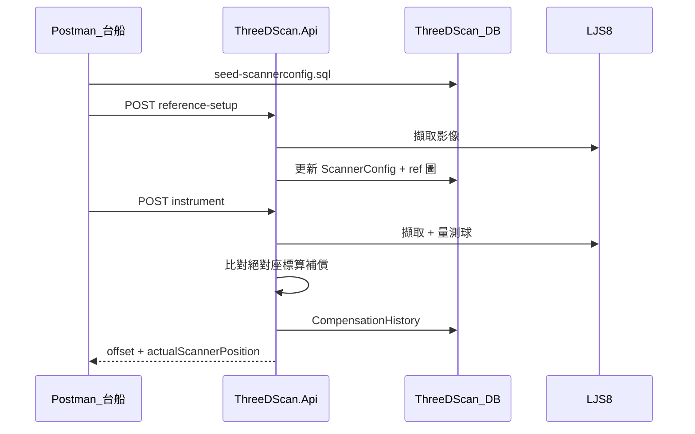

# 校正 API 呼叫說明

對應 SD V1.2 UC-01（儀器校正）與開發用 Ref 建立。  
基底 URL 以本機開發為例：`http://localhost:5295`（HTTPS：`https://localhost:7211`）。

---

## 啟動 Api

```powershell
dotnet run --project ThreeDScan.Api\ThreeDScan.Api.csproj
```

或於 Visual Studio / Cursor 啟動專案 `ThreeDScan.Api`。

連線設定見 `ThreeDScan.Api\appsettings.json`：

- 資料庫：`ThreeDScan` @ `127.0.0.1`
- 內容目錄：`Storage:ContentsRoot`（預設 `D:\3DScan\contents`）
- 掃描器：`Scanners`（如 `SURF-CAM-01` → `192.168.0.1`）
- 校正行為：`Calibration`（見下）

### Calibration 設定

```json
"Calibration": {
  "ResponseMode": "Production",
  "ClientId": "台船"
}
```

| 欄位 | 預設 | 說明 |
|------|------|------|
| `ResponseMode` | `Production` | `Production`＝正式回應（僅補償等）；`Debug`＝含診斷欄位 |
| `ClientId` | `台船` | 寫入 `OperationLog.ClientId` |

**本機 vs 正式（不必改來改去）**

| 檔案 | Api | WPF | 用途 |
|------|-----|-----|------|
| `appsettings.json` | ✓ | ✓ | 正式預設（`Production`）；**上線只維護這份** |
| `appsettings.Development.json` | ✓ | ✓ | 本機疊加（`ResponseMode: Debug`） |

- **Api**：`ASPNETCORE_ENVIRONMENT=Development` 時自動載入 Development 檔（Visual Studio F5 預設）。
- **WPF**：**Debug 建置**時自動疊加 Development 檔；**Release 建置**只用 `appsettings.json`。

---

## 前置準備（首次）

1. 執行 [`database/schema-v1.2.sql`](../database/schema-v1.2.sql) 建立資料表。
2. 執行 [`database/schema-v1.3-scannerconfig-calibration.sql`](../database/schema-v1.3-scannerconfig-calibration.sql) 擴充 `ScannerConfig` 校正欄位。
3. 執行 [`database/schema-v1.4-scanner-program-settings.sql`](../database/schema-v1.4-scanner-program-settings.sql) 拍攝群組參數備份表。
4. 執行 [`database/schema-v1.5-scanner-program-group-names.sql`](../database/schema-v1.5-scanner-program-group-names.sql) 群組名稱表。
5. 執行 [`database/schema-v1.6-scannerconfig-per-scanner.sql`](../database/schema-v1.6-scannerconfig-per-scanner.sql)（既有 DB）將 `ScannerConfig` 改為**每台掃描器一筆**。
6. 執行 [`database/seed-scannerconfig.sql`](../database/seed-scannerconfig.sql) 寫入 Ref 與校正參數種子（**每台掃描器一筆**）。
7. 確認 Keyence DLL 已放在 Api 輸出目錄（與 Winform 相同一套）。
8. 掃描器通訊正常、校正球已擺好。

### Ref 與拍攝群組

| 概念 | 儲存位置 | 數量 |
|------|----------|------|
| **Ref**（座標、量測參數、`ref_*.png`） | `ScannerConfig` + `{ContentsRoot}/{ScannerId}/` | 每台掃描器 **1 筆** |
| **拍攝參數**（曝光、光量、峰值…） | 控制器 program + `ScannerProgramSettings` | 每台 **16 群組** |

- `navigatorScanNo`：**1～16**，對應 WPF 群組項次與內部 `programNo = navigatorScanNo - 1`。
- `reference-setup`：更新該台 Ref；`navigatorScanNo` 僅決定**用哪個群組的拍攝設定掃描**（可省略，用 appsettings 預設）。
- `instrument`：讀同一筆 Ref 量測；`navigatorScanNo` 決定**掃描時用哪個群組的拍攝參數**。
- WPF 群組下拉顯示 `1. 群組一` → API 請帶 `"navigatorScanNo": 1`（**數字**，勿用字串）。

### WPF 掃描器拍攝參數

| 按鈕 | 行為 |
|------|------|
| 從控制器讀取 | 僅更新畫面（讀該群組 Save 區） |
| 從資料庫還原 | 僅更新畫面（讀 DB blob；需先對該群組「套用並 Save」） |
| 套用並 Save | 寫入控制器 Save + RUNNING，並備份至 `ScannerProgramSettings` |

### 建議呼叫順序



---

## 通用回應格式

```json
{
  "success": true,
  "timestamp": "2026-06-04T10:00:00+08:00",
  "data": { },
  "errorCode": null,
  "errorMessage": null
}
```

失敗時 `success` 為 `false`，`data` 為 `null`，並帶 `errorCode` / `errorMessage`。

### 外層欄位（所有校正 API 共用）

| 欄位 | 型別 | 說明 |
|------|------|------|
| `success` | boolean | 請求是否成功 |
| `timestamp` | string | **HTTP 回應**時間（ISO 8601，含時區） |
| `data` | object / null | 成功時為各 API 專屬物件；失敗為 `null` |
| `errorCode` | string / null | 失敗時錯誤代碼；成功為 `null` |
| `errorMessage` | string / null | 失敗時說明；成功為 `null` |

---

## 1. Ref 建立（開發用）

對應 LJScanWinform **校正**按鈕；寫入 `ScannerConfig` 與 `ref_*.png`，**不**推送 WPF 畫面。

| 項目 | 值 |
|------|-----|
| 方法 | `POST` |
| 路徑 | `/api/calibration/reference-setup` |
| Content-Type | `application/json` |

### Request

```json
{
  "scannerId": "SURF-CAM-01",
  "navigatorScanNo": 1,
  "operator": "test"
}
```

| 欄位 | 必填 | 說明 |
|------|------|------|
| `scannerId` | 是 | 掃描器 ID，須在 `appsettings` → `Scanners` 內 |
| `navigatorScanNo` | 否 | Scan **1～16**（項次 = API 值）；省略時用 Scanner 預設。僅影響**掃描用拍攝群組**，不影響 Ref 儲存位置 |
| `operator` | 否 | 操作者，寫入 DB |

### 成功回應（節錄）

```json
{
  "success": true,
  "data": {
    "scannerId": "SURF-CAM-01",
    "programNo": 0,
    "refPatternX": 159.735,
    "refPatternY": 388.755,
    "discoveredDiameter": 24.9,
    "contentsFolder": "D:\\3DScan\\contents\\SURF-CAM-01"
  }
}
```

### Response 欄位（`data`）

| 欄位 | 型別 | 說明 |
|------|------|------|
| `scannerId` | string | 掃描器 ID |
| `traceId` | string | 本次請求追溯 ID（寫入 `ScannerConfig.TraceId`） |
| `programNo` | number | 本次掃描使用的拍攝群組（`navigatorScanNo - 1`）；**非** Ref 儲存位置 |
| `refPatternX` / `refPatternY` | number | 更新後 PatternMatch 參考中心 (mm) |
| `discoveredDiameter` | number | 尋球/量測得到的代表球直徑 (mm) |
| `contentsFolder` | string | ref 圖與備份所在目錄 |
| `message` | string | 尋球/流程訊息（選填） |

### curl 範例

```bash
curl -X POST "http://localhost:5295/api/calibration/reference-setup" ^
  -H "Content-Type: application/json" ^
  -d "{\"scannerId\":\"SURF-CAM-01\",\"operator\":\"test\"}"
```

---

## 2. 儀器校正 UC-01

對應 LJScanWinform **量測** + 台船傳入預期位置與標準球絕對座標。  
成功時寫入 `CompensationHistory`；`ResponseMode: Debug` 時經 SignalR 推送完整內容至 WPF **校正監看**。

| 項目 | 值 |
|------|-----|
| 方法 | `POST` |
| 路徑 | `/api/calibration/instrument` |
| Content-Type | `application/json` |

### Request

```json
{
  "scannerId": "SURF-CAM-01",
  "machineArea": "printing",
  "navigatorScanNo": 1,
  "operator": "test",
  "cameraExpectedPosition": {
    "x": 1000.0,
    "y": 2000.0,
    "z": 500.0
  },
  "standardBalls": [
    {
      "ballId": "BALL-01",
      "knownX": 159.735,
      "knownY": 388.755,
      "knownZ": 12.5
    },
    {
      "ballId": "BALL-02",
      "knownX": 259.735,
      "knownY": 388.755,
      "knownZ": 12.5
    },
    {
      "ballId": "BALL-03",
      "knownX": 359.735,
      "knownY": 388.755,
      "knownZ": 12.5
    }
  ]
}
```

### 欄位說明

| 欄位 | 必填 | 說明 |
|------|------|------|
| `scannerId` | 是 | 面掃描器 ID |
| `machineArea` | 是 | `grinding` / `printing` / `cutting` |
| `navigatorScanNo` | 否 | Scan **1～16**；省略用設定檔。決定**掃描用拍攝群組**，Ref 仍為該台唯一一筆 `ScannerConfig` |
| `cameraExpectedPosition` | 是 | 掃描器**預期**絕對位置 (mm) |
| `standardBalls` | 是 | 標準球**已知絕對座標**，1～10 顆，**以台船傳入數量為準** |
| `standardBalls[].ballId` | 是 | 英數大寫 + 連字號，如 `BALL-01` |
| `standardBalls[].knownX/Y/Z` | 是 | 該球在機台/工件座標系的絕對位置 (mm) |
| `operator` | 否 | 操作者 |

> 儀器校正時 SDK 的 `DetectCount` = `standardBalls` 數量（1～10）；Ref 建立時 `BallCount` 取自 `ScannerConfig`。
>
> **現場只有 1 顆球時，`standardBalls` 只能傳 1 筆。** 傳 3 筆但桌上只有 1 顆 → 量得 1 顆仍會 `CAL_FEED_001`（需 3 僅得 1）。

### 補償計算概念

1. Api 驅動掃描器擷取影像，量得各球心與滾輪基準面（`datumPlane`）。
2. 將量測球與 `standardBalls` 配對。
3. **XY**：僅用配對球的 x/y 做 2D 剛體對齊反推掃描器水平位置（**不可**把 knownZ/measuredZ 納入 3D Kabsch，否則 XY 會錯）→ `offsetX/Y = d.xy − a.xy`。
4. **Z（滾輪／地板模型）**：  
   `scannerToFloorZ = c.z − (b.z − a.z)`（多球取平均）  
   `offsetZ = scannerToFloorZ − a.z`  
   `actualScannerPosition.z = scannerToFloorZ`  
   球心 Z 參與 Z 補償；`datumPlane` 僅 Debug 觀察。

> Z 語意：反推掃描器到滾輪面距離；預期 1100、量到 1089 → `offsetZ = −11`（比預期低 11 mm）。  
> 基準面量測失敗不影響 Z 補償（仍走球心模型）。  
> `rmse` 為**標準球兩兩 XY 球距誤差**之均方根 (mm)；Z 不計入 RMSE。

### 成功回應（節錄）

```json
{
  "success": true,
  "data": {
    "scannerId": "SURF-CAM-01",
    "traceId": "a1b2c3...",
    "compensation": {
      "offsetX": 1.234,
      "offsetY": -0.567,
      "offsetZ": 0.089
    },
    "actualScannerPosition": {
      "x": 1001.234,
      "y": 1999.433,
      "z": 500.089
    },
    "rmse": 0.08,
    "calibratedAt": "2026-06-04T10:30:00+08:00",
    "balls": [ ],
    "matchedBalls": [
      {
        "ballId": "BALL-01",
        "measuredX": 159.5,
        "measuredY": 388.2,
        "measuredZ": 12.4,
        "knownX": 159.735,
        "knownY": 388.755,
        "knownZ": 12.5,
        "residualMm": 0.08
      }
    ]
  }
}
```

### Response 欄位（`data`）

**`ResponseMode: Production`（預設，給台船）** 僅回傳：`scannerId`、`traceId`、`compensation`、`rmse`、`calibratedAt`。

**`ResponseMode: Debug`** 另含下方診斷欄位；失敗 `CAL_FEED_003` 時也會在 `data` 附診斷明細。

| 欄位 | 型別 | 說明 |
|------|------|------|
| `scannerId` | string | 掃描器 ID |
| `traceId` | string | 本次請求追溯 ID（寫入 `CompensationHistory.TraceId`） |
| `compensation` | object | **台船主要採用**：補償 offset (mm)，見下表 |
| `compensation.offsetX` | number | X 軸補償 = 實際掃描器 X − `cameraExpectedPosition.x` |
| `compensation.offsetY` | number | Y 軸補償 |
| `compensation.offsetZ` | number | Z 軸補償 = `scannerToFloorZ − cameraExpectedPosition.z` |
| `actualScannerPosition` | object | **Debug**：反推掃描器實際位置；`x`/`y` 由 **2D** 球配對反推，`z` = `scannerToFloorZ` |
| `rmse` | number | 球距誤差 RMSE (mm)；寫入 `CompensationHistory.Rmse` |
| `calibratedAt` | string | **校正完成時間**（ISO 8601）；業務上記錄「何時算出此組補償」 |
| `balls` | array | **Debug**：直徑在容差內的量測球（`ok: true`）；不合格球暫不回傳 |
| `balls[].index` | number | 球序號（0 起） |
| `balls[].x` / `y` / `z` | number | 球心座標 (mm)，**掃描器座標系** |
| `balls[].diameter` | number | 擬合直徑 (mm) |
| `balls[].ok` | boolean | 固定為 `true`（僅回傳合格球） |
| `matchedBalls` | array | **Debug**：與 `standardBalls` 配對後的明細 |
| `matchedBalls[].ballId` | string | 對應 Request 的 `standardBalls[].ballId` |
| `matchedBalls[].measuredX/Y/Z` | number | 該顆量測球心 (掃描器座標系) |
| `matchedBalls[].knownX/Y/Z` | number | 台船傳入的已知絕對座標 |
| `matchedBalls[].residualMm` | number | 該球參與之球距誤差最大值 (mm) |
| `datumPlane` | object / null | **Debug**：滾輪基準面（`LPlaneTool`）；僅觀察，不參與 Z 補償 |
| `datumPlane.ok` | boolean | 平面量測是否成功 |
| `datumPlane.planeA/B/C` | number | 平面方程式係數 |
| `datumPlane.planeZAtRegionCenter` | number | ROI 中心處基準面 Z (mm) |
| `datumPlane.firstBallRelativeZ` | number | 第一顆球心 Z − 該 XY 處基準面 Z (mm) |
| `scannerToFloorZ` | number | **Debug**：由配對球心 Z 反推（地板模型）；見下 |

**`scannerToFloorZ`（地板模型）**

```
scannerToFloorZ = measuredZ − (knownZ − cameraExpectedPosition.z)
                = c.z − (b.z − a.z)        （單球）
compensation.offsetZ = scannerToFloorZ − cameraExpectedPosition.z
```

多球時 `scannerToFloorZ` 對配對結果取平均。

### 補償值驗證（手動對照）

成功回應後，用 Request 的 `cameraExpectedPosition`（記為 **a**）與 `data` 內欄位驗算：

**恆等式（一定成立）**

```
offsetX = actualScannerPosition.x − a.x
offsetY = actualScannerPosition.y − a.y
offsetZ = scannerToFloorZ − a.z
```

**Z（每顆配對球各算，再取平均）**

```
floorZ_i = matchedBalls[i].measuredZ − (matchedBalls[i].knownZ − a.z)
scannerToFloorZ = mean(floorZ_i)
```

**XY**

| 球數 | 反推掃描器實際位置 d.xy | 補償 |
|------|---------------------------|------|
| 單球 | `d.x = knownX − measuredX`（Y 同理） | `offset = d − a` |
| 多球 | **2D** Kabsch 反推 → `actualScannerPosition.x/y` | `offset = d − a` |

**建議流程**

1. 確認 `success: true` 且 RMSE 已過門檻。  
2. 先驗 **Z**：用 `matchedBalls` 代入 `floorZ_i`，平均後應等於 `scannerToFloorZ`，`offsetZ` 應等於其減 `a.z`。  
3. 再驗 **XY**：`compensation.offsetX/Y` 應等於 `actualScannerPosition.x/y − a.x/y`。  
4. 單球可再加驗：`offsetX ≈ (knownX − measuredX) − a.x`。

若步驟 2～4 都對，表示補償計算與 API 回傳一致。

### RMSE（球距誤差）

**目的**：驗證標準球之間的**相對幾何**（球距）是否與台船 `knownX/Y` 一致，而非單顆絕對座標。僅用 XY，不含 Z。

對每一對已配對球 `(i, j)`：

```
KnownDistance_ij    = √[(knownX_j − knownX_i)² + (knownY_j − knownY_i)²]
MeasuredDistance_ij = √[(measuredX_j − measuredX_i)² + (measuredY_j − measuredY_i)²]
Error_ij            = |KnownDistance_ij − MeasuredDistance_ij|
```

`n` 顆球共有 `n×(n−1)/2` 組：

```
RMSE = √[ Σ Error_ij² / PairCount ]
```

| 情況 | RMSE |
|------|------|
| 單球 | 0（無球距可比） |
| RMSE < 1.0 mm | 成功 |
| RMSE ≥ 1.0 mm | `CAL_FEED_003` |

`matchedBalls[].residualMm`：該球參與之球距誤差的**最大值**（除錯用）。

**範例**（兩球）：known 距 287.14 mm、measured 距 274.41 mm → Error = 12.73 mm → RMSE = 12.73 mm → 失敗。

> `timestamp`（外層）為 API 回應時間；`calibratedAt` 為校正業務時間，兩者可能差數十毫秒。

### LJ 校正參數（球徑、基準面）

**設定位置：`dbo.ScannerConfig`（每台掃描器一筆，`PK = ScannerId`）**  
種子資料見 [`database/seed-scannerconfig.sql`](../database/seed-scannerconfig.sql)。

換球或調整基準面 ROI 時在 DB 更新即可，**不必改 appsettings / 重 build**：

```sql
UPDATE dbo.ScannerConfig
SET ExpectedBallDiameter = 40,
    MaxDiameterError = 5.0,
    DiameterTolerance = 1.0
WHERE ScannerId = N'SURF-CAM-01';
```

`reference-setup` 成功後會將量到的 `discoveredDiameter` **寫回** `ExpectedBallDiameter`。

| DB 欄位 | 說明 |
|---------|------|
| `ExpectedBallDiameter` | 預期球直徑 (mm) |
| `DiameterTolerance` | 回傳 `balls[].ok` 門檻 |
| `MaxDiameterError` | SDK 保留球直徑門檻 |
| `BallCount` | Ref 建立時 PatternMatch 上限 |
| `DatumPlane*` | 滾輪基準面 ROI |

### 基準面 ROI 設定（`DatumPlane*`，`ScannerConfig` 表）

| 欄位 | 說明 |
|------|------|
| `Enabled` | 是否啟用 `LPlaneTool`（預設 `true`） |
| `CenterX/Y` | 滾輪面 ROI 中心（畫在治具／滾輪平整區，避開球） |
| `Width/Height` | ROI 尺寸 (mm) |
| `Angle` | ROI 旋轉角 |

reference-setup 時會對平面 `UpdateReference`；instrument 量測時可選量基準面回傳 `datumPlane`（Debug）。**Z 補償仍由球心地板模型計算**。

### curl 範例（單球）

```bash
curl -X POST "http://localhost:5295/api/calibration/instrument" ^
  -H "Content-Type: application/json" ^
  -d "{\"scannerId\":\"SURF-CAM-01\",\"machineArea\":\"printing\",\"cameraExpectedPosition\":{\"x\":1000,\"y\":2000,\"z\":500},\"standardBalls\":[{\"ballId\":\"BALL-01\",\"knownX\":159.735,\"knownY\":388.755,\"knownZ\":12.5}]}"
```

### 操作稽核（OperationLog）

每次 `instrument` / `reference-setup` 呼叫（成功或失敗）會寫入 `OperationLog`：

| 欄位 | 說明 |
|------|------|
| `TraceId` | 與 API 回應 `traceId` 相同 |
| `Action` | `CalibrateInstrument` 或 `SetupReference` |
| `Result` | `Success` / `Fail` |
| `ErrorCode` | 失敗時如 `CAL_FEED_003` |
| `Detail` | 失敗時為 `errorMessage`；成功 instrument 為 offset 摘要 |

成功補償仍另寫 `CompensationHistory`；`OperationLog` 用於查失敗紀錄與操作軌跡。

### 錯誤代碼

| errorCode | HTTP | 說明 |
|-----------|------|------|
| `CAL_CFG_001` | 400 | 未知 `scannerId` |
| `CAL_CFG_003` | 400 | 無 `ScannerConfig`；請先執行 `seed-scannerconfig.sql`，再 `reference-setup` |
| `CAL_FEED_001` | 400 | 標準球未偵測到、數量不足或配對失敗 |
| `CAL_FEED_003` | 400 | RMSE ≥ 1.0 mm，不寫入 `CompensationHistory`；`ResponseMode: Debug` 時 `data` 含診斷明細 |
| `CAL_SDK_001` | 500 | LJ SDK / 掃描失敗 |
| `CAL_SYS_001` | 500 | 其他系統錯誤 |

---

## Postman / VS Code REST Client

專案內範例檔：[`ThreeDScan.Api/ThreeDScan.Api.http`](../ThreeDScan.Api/ThreeDScan.Api.http)

將第一行改為：

```http
@ThreeDScan.Api_HostAddress = http://localhost:5295
```

即可在編輯器內直接 **Send Request**。

---

## WPF 校正監看（選用）

1. 啟動 `ThreeDScan.Api`
2. 啟動 WPF 專案 `ThreeDScan`
3. 開啟 **校正監看** Tab
4. 呼叫 `POST /api/calibration/instrument` 後會收到 SignalR 預覽

**與 Api 相同**：`Production` 時 **WPF 不顯示「校正監看」Tab**（也不連 SignalR）；`Debug` 時才出現 Tab，並顯示球清單、配對與 3D。本機 F5（Debug 建置）兩邊皆自動讀 `appsettings.Development.json`，無需手動切換。

| 設定 | 位置 | 預設 |
|------|------|------|
| Hub | `ThreeDScan/appsettings.json` → `CalibrationMonitor:HubUrl` | `http://localhost:5295/hubs/calibration-preview` |
| 預覽靜態檔 | Api `Storage:ContentsRoot` | `/calibration-preview-files/...` |

---

## 相關路徑

| 路徑 | 說明 |
|------|------|
| `D:\3DScan\contents\{ScannerId}\` | ref 圖、備份、預覽圖 |
| `D:\3DScan\contents\logs\measure_*.log` | LJ 量測日誌 |
| `dbo.ScannerConfig` | Ref 座標（每台掃描器一筆；種子 + reference-setup 更新） |
| `dbo.ScannerProgramSettings` | 拍攝群組參數備份（WPF Save） |
| `dbo.ScannerProgramGroupName` | 群組顯示名稱 |
| `dbo.CompensationHistory` | 儀器校正補償歷程 |
