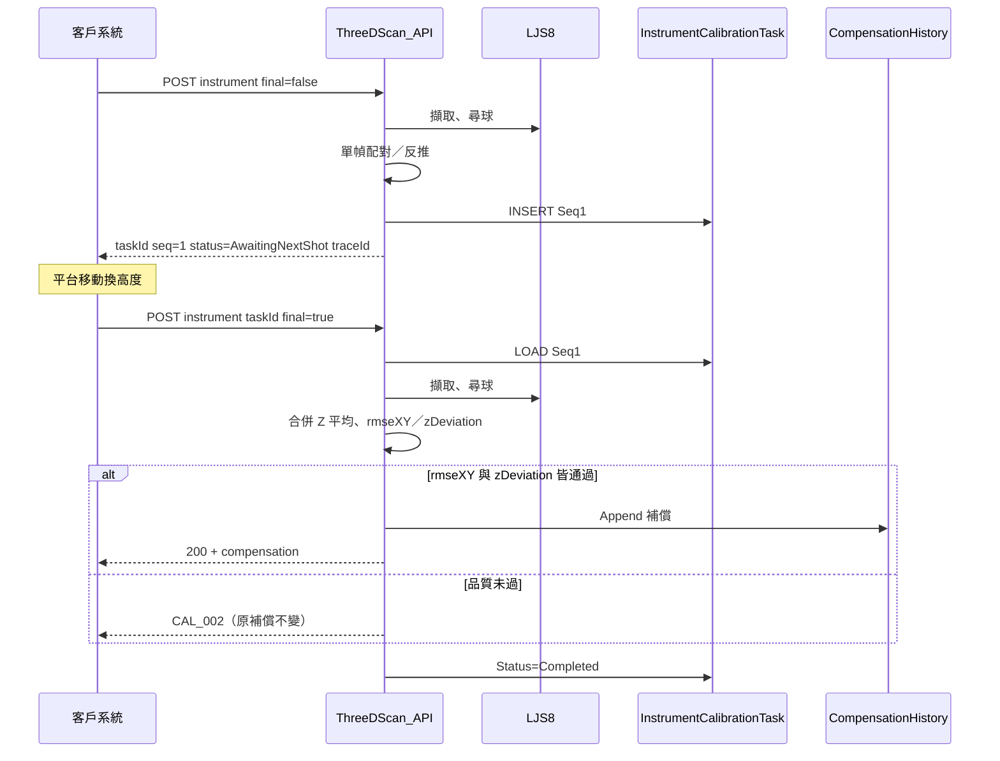

# 儀器校正（UC-01）實作邏輯說明

本文件說明 ThreeDScan 系統如何實作**儀器校正**功能，供客戶確認演算法與流程是否符合需求。  
技術串接細節請另見 [api-calibration.md](../api-calibration.md)，並對齊《3D掃描應用服務系統_API串接規格文件》v1.0 §4。

---

## 1. 功能目的

標準球固定於平台，平台移動一次、共拍攝兩次；第二次呼叫時完成 XY／Z 補償計算與品質判定。

1. **兩次拍攝**標準校正球（平台換高度）
2. 比對客戶提供的**球已知絕對座標**與掃描器量測結果
3. 各幀反推掃描器位置；**Z 取兩次平均**
4. 以 **rmseXY** 與 **zDeviation** 判定是否寫入補償
5. 通過則回傳 `compensation`；未通過則 `CAL_002`

客戶從 API 取得補償後**自行套用**；本系統不另提供「查詢最新補償」API。

---

## 2. 整體流程



**前置條件**：該掃描器須先完成 **Ref 建立**。  
**Task 暫存**：寫入 DB 表 `InstrumentCalibrationTask`（TTL 預設 30 分，見 `Calibration:InstrumentTaskTtlMinutes`）。

---

## 3. 客戶提供 vs 系統量測

| 來源 | 內容 | 用途 |
|------|------|------|
| **客戶（Request）** | `cameraExpectedPosition` | 補償 = 實際 − 預期（Seq=2 用第二次的 a） |
| **客戶（Request）** | `standardBalls[]` 絕對座標 | 配對、反推；兩幀球數須相同 |
| **客戶（Request）** | `final` / `taskId` | 兩次拍攝契約 |
| **系統** | 量測球心與直徑 | 配對與補償計算 |
| **系統** | `scannerId` → MachineArea | 寫入補償歷程用，不由 Request 傳 |

---

## 4. 核心計算邏輯

記：**a**＝預期位置，**b**＝known，**c**＝measured。

### 4.1 配對（每幀）

僅 **XY**；Z 不參與配對。

### 4.2 X / Y（每幀）

單球：`d.xy = b.xy − c.xy`；多球：2D Kabsch。  
合併時：`actualXY = (d1.xy + d2.xy) / 2`，`offsetXY` 相對**第二次**的 a。

### 4.3 Z（每幀地板模型 + 兩幀平均）

```
Z_i = 平均 [ c.z − (b.z − a.z) ]     （該幀）
scannerToFloorZ = (Z1 + Z2) / 2
zDeviation           = |Z1 − Z2|          （規格稱兩次估計值 RMSE；目前以絕對差實作，門檻待實測）
offsetZ         = scannerToFloorZ − a2.z
```

基準面 `datumPlane` 僅 Debug，**不參與** Z 補償。

### 4.4 品質判定與寫入

| 條件 | 結果 |
|------|------|
| `rmseXY = max(rmse1,rmse2) < 1.0` 且 `zDeviation < ZDeviationThresholdMm`（預設 1.0） | HTTP 200，寫入 `CompensationHistory` |
| 任一未過 | `CAL_002`，不寫補償，原有效補償不變 |
| taskId 不存在／逾時／契約錯誤 | `CAL_001` |
| 球數不足／配對失敗 | `CAL_FEED_001` 等 |

---

## 5. 成功與失敗

### 第一次（Production）

- `taskId`、`seq=1`、`status=AwaitingNextShot`、`traceId`

### 第二次成功（Production）

- `scannerId`、`compensation`、`rmseXY`、`zDeviation`、`calibratedAt`、`traceId`
- 寫入 `CompensationHistory` 與 `OperationLog`

### 失敗

| 情況 | 說明 |
|------|------|
| 品質未過 | `CAL_002` |
| taskId 不存在／逾時／契約錯誤 | `CAL_001` |
| 無 Ref／未知掃描器 | `CAL_CFG_*` |
| 球未偵測／配對失敗 | `CAL_FEED_001` |
| SDK／系統 | `CAL_SDK_001`／`CAL_SYS_001` |

---

## 6. 客戶端建議確認事項

1. **必須兩次拍攝**；單次 `final=true` 會被拒絕。
2. 補償定義：offset = 實際 − 預期；由貴司套用。
3. Z：兩次反推平均；品質看 `zDeviation`（門檻待實測）。
4. `rmseXY`：僅 XY 球距；不含 Z。
5. 收到 `CAL_002` 時請沿用先前有效補償。
