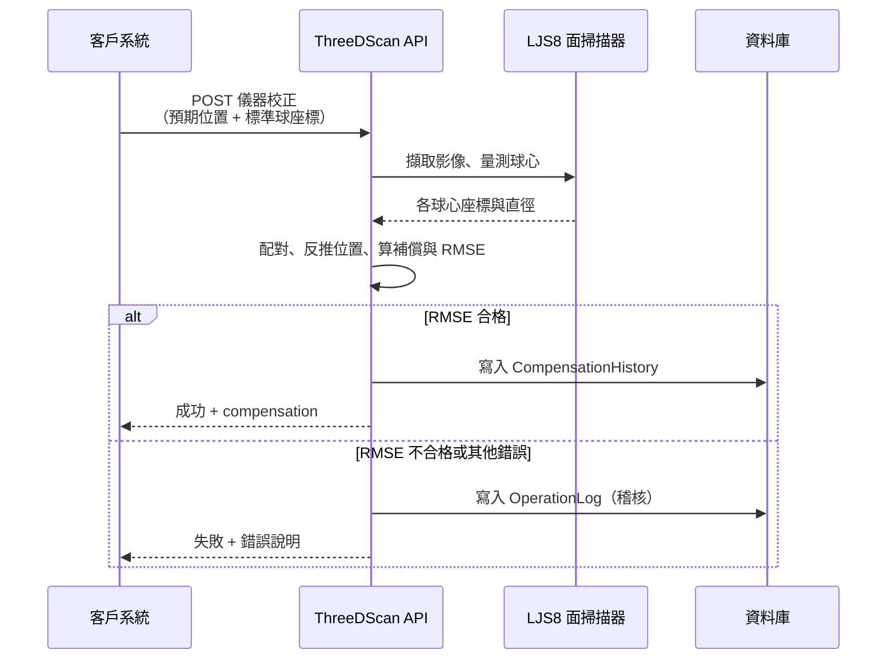

# 儀器校正（UC-01）實作邏輯說明

本文件說明 ThreeDScan 系統如何實作**儀器校正**功能，供客戶確認演算法與流程是否符合需求。  
技術串接細節（API 欄位、錯誤碼、Postman 範例）請另見 [api-calibration.md](../api-calibration.md)。

---

## 1. 功能目的

當面掃描器移動到指定位置後，系統會：

1. 掃描現場擺設的**標準校正球**
2. 比對客戶提供的**球已知絕對座標**與掃描器量測結果
3. 反推掃描器**實際位置**與**位置誤差（補償值）**
4. 以品質指標（RMSE）判定是否接受此次校正
5. 通過時將補償值回傳給客戶，並寫入資料庫備查

客戶從 API 回應取得 `compensation`（offsetX / offsetY / offsetZ）後，**自行套用至後續掃描流程**；本系統不另提供「查詢最新補償」API。

---

## 2. 整體流程



**前置條件**：該掃描器須先完成 **Ref 建立**（參考影像與設定寫入資料庫），否則無法執行儀器校正。

---

## 3. 客戶提供 vs 系統量測

| 來源 | 內容 | 用途 |
|------|------|------|
| **客戶（Request）** | 掃描器預期絕對位置 `cameraExpectedPosition` | 作為「應到達位置」，補償 = 實際 − 預期 |
| **客戶（Request）** | 各標準球已知絕對座標 `standardBalls[]`（1～10 顆） | 與量測球配對、反推掃描器位置 |
| **系統（掃描器）** | 各球心座標（掃描器座標系）與擬合直徑 | 與已知座標比對、計算補償 |

球數以客戶傳入的 `standardBalls` 數量為準；系統依該數量向掃描器要求偵測對應顆數的球。

---

## 4. 核心計算邏輯

以下記：

- **a** = 客戶傳入的掃描器預期位置（`cameraExpectedPosition`）
- **b** = 某顆標準球的已知絕對座標（`knownX/Y/Z`）
- **c** = 該顆球在掃描器座標系下的量測球心（`measuredX/Y/Z`）

### 4.1 標準球配對

將客戶傳入的每顆標準球，與掃描器量測到的球做 **1:1 配對**。

- 配對僅依據 **XY 平面**上的相對位置關係
- **Z 不參與配對**：已知 Z 為機台絕對高度，量測 Z 為掃描器座標，兩者語意不同，不宜直接比較
- 作法：先以 XY 質心粗對齊，再以最小總 XY 距離做最佳指派

### 4.2 X / Y 補償（反推掃描器水平位置）

由配對結果反推掃描器實際水平位置 **d.xy**：

| 球數 | 作法 |
|------|------|
| **1 顆** | `d.x = b.x − c.x`，`d.y = b.y − c.y` |
| **2 顆以上** | 以配對球的 XY 做 **2D 剛體對齊**（含水平平移與旋轉），求得掃描器實際 XY |

補償：

```
offsetX = d.x − a.x
offsetY = d.y − a.y
```

> 不使用 3D 剛體對齊反推 XY，避免 Z 座標語意混用而污染水平結果。

### 4.3 Z 補償（地板／滾輪模型）

Z 補償由**配對球心 Z** 與台船 **knownZ** 推算掃描器到滾輪面距離，多球取平均：

```
scannerToFloorZ = 平均 [ c.z − (b.z − a.z) ]   （對所有配對球）

offsetZ = scannerToFloorZ − a.z
```

反推的掃描器實際 Z 即 `scannerToFloorZ`。

> Keyence `LPlaneTool` 基準面（`datumPlane`）僅 Debug 回傳供觀察，**不參與 Z 補償**（待與客戶確認最終 Z 定義後再調整）。

### 4.4 品質判定（RMSE）

採**球距誤差 RMSE**評估配對品質（僅 XY，不含 Z）：

1. 對每一對配對球，計算「已知 XY 距離」與「量測 XY 距離」之差的絕對值
2. 將所有球對的距離誤差取均方根，得到 RMSE（mm）
3. **僅 1 顆球時**無法驗證球間相對幾何，RMSE 視為 0

**合格門檻：RMSE &lt; 1.0 mm**

- RMSE ≥ 1.0 mm → 校正**失敗**，不寫入補償紀錄，回傳錯誤說明
- RMSE &lt; 1.0 mm → 校正**成功**，回傳補償並寫入資料庫

---

## 5. 成功與失敗的系統行為

### 成功

- HTTP 回應 `success: true`
- 回傳 **補償值**（`compensation`）、**RMSE**、**traceId**、**校正時間**
- 寫入 `CompensationHistory`（補償紀錄）
- 寫入 `OperationLog`（操作稽核）

正式環境回應僅含上述必要欄位；除錯環境可另含配對明細、量測球座標等診斷資訊。

### 失敗（常見原因）

| 情況 | 說明 | 是否寫入補償 |
|------|------|--------------|
| 掃描器未設定 | 尚未執行 Ref 建立 | 否 |
| 球未偵測到或數量不足 | 量得球數少於客戶要求 | 否 |
| 配對失敗 | 無法將標準球與量測球一一對應 | 否 |
| RMSE 超標 | 球間距離誤差過大（≥ 1.0 mm） | 否 |
| 掃描器／SDK 異常 | 通訊或量測失敗 | 否 |

失敗時一律寫入 `OperationLog`（含錯誤訊息），供事後查詢；**不寫入** `CompensationHistory`。

---

## 6. 客戶端建議確認事項

請依貴司需求核對下列邏輯是否可接受：

1. **補償定義**：offset = 掃描器實際位置 − 客戶宣告的預期位置；由貴司套用至後續流程。
2. **XY 反推**：依標準球已知座標與量測座標的平面幾何關係；多球時允許水平旋轉修正。
3. **Z 反推**：依配對球 **knownZ + 量測球心 Z** 的地板模型；基準面僅供 Debug。
4. **RMSE**：驗證的是標準球之間的**相對距離**是否一致（XY），不是逐點座標殘差，也不含 Z。
5. **球數**：支援 1～10 顆；球數越多，RMSE 越能反映整體幾何品質。
6. **單球校正**：可算出補償，但 RMSE 恆為 0，無法以球距驗證品質。

---

## 7. 不在本功能範圍內

- 客戶端如何將補償值套用至運動控制或掃描流程
- 查詢歷史補償的獨立 API（補償隨本次回應提供）
- 以滾輪基準面取代地板模型計算 Z 補償（待與客戶確認規格）
- 現場 WPF 監看畫面（正式環境不啟用，僅開發除錯用）

---

## 8. 相關文件

| 文件 | 內容 |
|------|------|
| [api-calibration.md](../api-calibration.md) | API 呼叫方式、Request/Response 欄位、錯誤碼 |
| [ARCHITECTURE.md](../../ARCHITECTURE.md) | 系統架構摘要 |

---

*文件版本：對應 ThreeDScan UC-01 現行實作（球距 RMSE、2D XY 反推、球心地板模型 Z、RMSE 門檻 1.0 mm）。*
