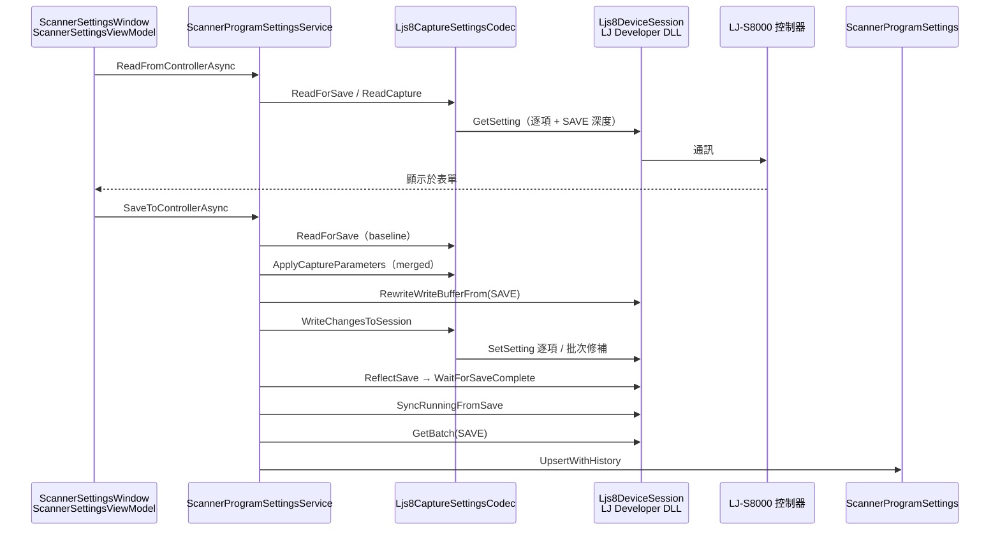

# 掃描器拍攝參數（LJ-S8000）

本文件說明 ThreeDScan WPF **掃描器拍攝參數**功能的用途、操作流程，以及與 Keyence LJ-S8000 控制器通訊的實作邏輯。  
對照依據為 Keyence **LjDevCommunication（LJ-S8000）** 手冊 **§10.3.3 各程式內設定**，並補充本專案在實機上驗證過的讀寫差異。

---

## 1. 功能目的

系統透過 **LJ Developer Communication DLL** 讀寫面掃描器各 Scan 程式的拍攝設定，對應 Navigator 中的 Scan 程式參數（不含 PC 端圖像過濾）。

主要能力：

| 能力 | 說明 |
|------|------|
| **從控制器讀取** | 選定掃描器與群組後，以 SAVE 深度讀取目前程式設定並顯示於畫面 |
| **套用並 Save** | 將畫面參數寫入控制器 WRITE 緩衝、Reflect 至 SAVE，並同步 RUNNING |
| **資料庫備份** | Save 成功後，將完整程式設定 blob 寫入 `ScannerProgramSettings` 與歷史表 |
| **從資料庫載入** | 僅還原畫面顯示，不寫入攝影機；要生效須再按「套用並 Save」 |

每台掃描器可對應多個 **程式群組**（Program 0～15），各群組綁定一個 `ProgramNo`，與 Navigator 的 Scan 編號對應（`ProgramNo = NavigatorScanNo - 1`）。

---

## 2. 操作說明（使用者）

### 2.1 開啟畫面

主畫面 → **掃描器拍攝參數**（`ScannerSettingsWindow`）。

### 2.2 建議操作順序

1. 選擇 **掃描器** 與 **群組**（選群組後會自動從控制器讀取）
2. 調整參數
3. 按 **套用並 Save** 寫入控制器並備份資料庫

### 2.3 注意事項

- **Save 前請關閉 Navigator**，避免兩端同時寫入同一程式設定而互相覆蓋
- **Y 方向數據間隔 (mm)** 僅顯示（來自 `appsettings` 的 `YDataIntervalMm`），**不會寫入控制器**
- 光量控制為 **自動 / SLOPE** 時，曝光時間由控制器自行調整；若要手動控曝光，須先設為 **手動**
- 操作進行中畫面會顯示忙碌狀態，避免重複送出指令

---

## 3. 軟體架構



### 3.1 主要程式檔案

| 檔案 | 職責 |
|------|------|
| `ThreeDScan/Views/ScannerSettingsWindow.xaml` | 拍攝參數 UI |
| `ThreeDScan/ViewModels/ScannerSettingsViewModel.cs` | 讀取、Save、資料庫載入與表單狀態 |
| `ThreeDScan.Infrastructure/Scanners/ScannerProgramSettingsService.cs` | 連線、Save 流程編排、DB 持久化 |
| `ThreeDScan.Infrastructure/Scanners/Ljs8ProgramSettingsClient.cs` | Cat/Item 對照、`Ljs8CaptureSettingsCodec` 讀寫實作 |
| `ThreeDScan.Domain/Models/ScannerCaptureSettings.cs` | 領域模型（UI 與 SDK 之間的參數集合） |

---

## 4. 控制器設定深度

LJ-S SDK 對同一程式維護三層設定緩衝：

| 深度 | 常數 | 用途 |
|------|------|------|
| WRITE | `0` | 暫存寫入緩衝；`SetSetting` 的目標 |
| RUNNING | `1` | 量測／掃描當下生效的設定 |
| SAVE | `2` | 已 Save 的持久設定；UI 讀取基準 |

本功能慣例：

- **讀取顯示**：一律以 **SAVE** 為準（與 Navigator Save 後內容一致）
- **寫入 Save**：先 `RewriteTemporarySetting(SAVE)` 初始化 WRITE → 逐項寫入 → `ReflectSetting(SAVE)` → `SyncRunningFromSave()`
- **僅套用 Running**（`ApplyRunningSettingsAsync`）：不 Reflect Save，只更新 RUNNING，供測試掃描等情境

---

## 5. 參數對照表（Cat / Item）

以下為 **LJ-S8000 §10.3.3** 與本專案 `Ljs8CaptureSettingTargets` 的對應。  
**讀取長度**依手冊；**寫入長度**為實機驗證結果（可能與手冊讀取長度不同）。

### 5.1 間隔點數（Category `0x03`）

| UI 欄位 | Item | 讀取 | 寫入 (`SetSetting`) | 值域 |
|---------|------|------|---------------------|------|
| Y 方向間隔倍數 | `0x01` | 1 byte | **4 byte** | SDK：1～8（UI：0=OFF 對應 SDK 1；2～8 直接對應） |

### 5.2 感光／光量（Category `0x04`）

| UI 欄位 | Item | 讀取 | 寫入 | 值域 |
|---------|------|------|------|------|
| 曝光時間 | `0x00` | 1 byte | **4 byte** | 0～15 |
| 動態範圍 | `0x01` | 1 byte | **4 byte** | 1～9 |
| 光量控制模式 | `0x02` | 1 byte | **4 byte** | 0=手動、1=自動、2=SLOPE |
| 光量控制上限 | `0x03` | 1 byte | **4 byte** | 1～99 |
| 光量控制下限 | `0x04` | 1 byte | **4 byte** | 1～99 |

### 5.3 峰值處理（Category `0x05`）

| UI 欄位 | Item | 讀取 | 寫入 | 值域 / 備註 |
|---------|------|------|------|-------------|
| 峰值檢測靈敏度 | `0x00` | 1 byte | **4 byte** | 1～5 |
| 峰值選擇 | `0x01` | **16 byte** | **16 byte** | byte0 = 選擇 0～5；讀-改-寫保留其餘 15 byte |
| **半透明體峰值處理** | `0x02` | 1 byte | **見 §6** | 0=OFF、1=ON |
| 光暈過濾器 ON/OFF | `0x03` byte0 | 2 byte | **4 byte** | 0/1 |
| 光暈過濾器強度 | `0x03` byte1 | 同上 | **4 byte** | 1～5 |

### 5.4 死角（Category `0x06`）

| UI 欄位 | Item | 讀取 | 寫入 | 值域 |
|---------|------|------|------|------|
| 死角資料插補 | `0x00` | 1 byte | **4 byte** | 0=不插補、1=水平/垂直、2=線性 |

---

## 6. 半透明體峰值處理（特殊實作）

### 6.1 問題背景

Cat `0x05` Item `0x02`（半透明體）在實機上：

- `GetSetting` **可**以 1 byte 正常讀取
- 單項 `SetSetting(Write)` 無論 buffer 為 1 / 2 / 4 / 16 byte，皆回 **0x8032（32818）**「設定資料長度與規定不符」

因此無法與其他欄位相同，以逐項 `SetSetting` 寫入。

### 6.2 解法：程式批次 blob 修補

控制器每個 Scan 程式有一份 **10980 byte** 的批次設定（`ProgramSettingsBatchSize`）。半透明體實際儲存於此 blob 的某一 byte，而非可獨立寫入的單項結構。

流程（`WriteChangesToSession`）：

1. **寫入前**（WRITE 已與 SAVE 同步）：`FindTranslucentBatchOffset` 定位 blob 內 byte 偏移
2. **先完成**其餘欄位的逐項 `SetSetting`
3. **最後**：`GetBatch(WRITE)` → 修改該 offset → `SetBatchWrite` 整份 blob

> 半透明體必須放在**最後**寫入。若在逐項寫入前先整批灌入 WRITE，會使 WRITE 緩衝與控制器狀態不一致，導致後續逐項寫入被拒絕（0x8032 / 0x8050 等）。

### 6.3 偏移定位演算法

1. 以 SAVE 深度讀取半透明體目前值（0 或 1）
2. 讀取 SAVE 批次 blob（10980 byte）
3. 在 blob 中搜尋 **峰值選擇 16-byte 區塊**（比對 `GetSetting` 讀回的 16 byte pattern）
4. 在該區塊後方約 48 byte 範圍內，找出值等於目前半透明體狀態的候選 offset  
   - 實測：**半透明體位於 `peakBlock + 16`**（例如 peakBlock=108 → offset=124）
5. 對候選 offset 以 `TrySetBatchWrite` 探測（改為相反值後讀回 Item `0x02` 驗證）
6. 探測失敗的候選**不可拋錯中斷**（停用時改錯誤 byte 為 0 可能觸發 32834），須還原 WRITE 後繼續下一候選
7. 成功後將 offset **依 ProgramNo 快取**，後續 Save 直接重用

### 6.4 寫入後驗證

`WriteTranslucentViaBatch` 在 `SetBatchWrite` 後，以 WRITE 深度再次 `GetSetting` Item `0x02`，確認讀回值與目標一致。

---

## 7. Save 完整流程（開發參考）

`ScannerProgramSettingsService.SaveToControllerCore`：

```
1. OpenSession → EnsureProgram → EnsureMemoryReady
2. original ← ReadForSave（SAVE 深度）
3. merged ← ApplyCaptureParameters(UI)
4. 若與 original 相同 → 僅更新 DB trace，結束
5. RewriteWriteBufferFrom(SAVE)          // WRITE ← SAVE
6. WriteChangesToSession(original, merged)
7. ReflectSave()
8. WaitForSaveComplete()
9. SyncRunningFromSave()               // RUNNING ← SAVE
10. GetBatch(SAVE) → PersistSaveBlob   // 寫入 DB
```

`WriteChangesToSession` 僅對**有變更**的欄位呼叫寫入，順序大致為：

曝光／動態範圍／光量 → Y 間隔 → 峰值靈敏度 → 峰值選擇 → 光暈過濾器 → 死角插補 → **半透明體（批次修補，最後）**

---

## 8. 資料庫備份

Save 成功後，以 `GetBatch(SAVE)` 取得完整程式設定二進位 blob，寫入：

- `dbo.ScannerProgramSettings`（最新一筆）
- `dbo.ScannerProgramSettingsHistory`（歷史）

主鍵：`(ScannerId, ProgramNo)`。

**從資料庫載入**時：將 blob 灌入 SDK WRITE 緩衝（`SetBatchWrite`），再以 WRITE 深度解讀各 Cat/Item 填回 UI，**不** Reflect 至控制器。

---

## 9. DLL 與連線限制

- `Ljs8If.Initialize()` 全行程**只能呼叫一次**；不可每次操作後 `Finalize`
- LJ Developer DLL 為**行程全域**（device id 固定 0），所有掃描器操作須透過 `DeviceGate` **互斥**序列化
- 並行對兩台掃描器下指令可能導致 `NotOpen (0x1001)`

---

## 10. 常見錯誤碼

| 錯誤碼 | 十六進位 | 可能原因 |
|--------|----------|----------|
| 32818 | 0x8032 | `SetSetting` buffer 長度不符；或 WRITE 緩衝狀態不一致 |
| 32834 | 0x8042 | 參數錯誤（`GetSetting` / `SetSetting` Cat·Item 或長度不符；批次探測改到無效 byte 時也可能出現） |
| 32840 | 0x8048 | 成像處理進行中，須停止量測後再 Save |
| 32848 | 0x8050 | WRITE 緩衝與控制器設定不一致 |
| 32850 | 0x8052 | 同上（常見於批次與逐項混用順序錯誤） |
| 32849 | 0x8051 | 感測頭啟動中（`GetSetting`），請待約 50 秒後再試 |
| 4097 | 0x1001 | DLL 未開啟或連線被其他操作關閉 |

---

## 11. 與 LJ-X 系列之差異

本專案針對 **LJ-S8000**，Cat/Item 編號與舊版 LJ-X 不同（例如 LJ-X 半透明體曾出現在 Cat `0x03` Item `0x01` 的 24-byte 結構）。  
請勿沿用 LJ-X 通訊文件或舊版 `LJScanTest` 的對照表。

---

## 12. 維護備註

- 讀寫長度以 `Ljs8CaptureSettingTargets.GetSetDataLength` 與 `WriteChangesToSession` 為準；變更前請在實機逐項驗證
- 若韌體升級後半透明體 offset 改變，可清除程序內 `TranslucentBatchOffsets` 快取（重啟應用程式）或重新觸發探測
- 手冊路徑（本機參考）：`Keyence\LjDevCommunication-Manual_1_5_0_0_TW\` §10.3.3
